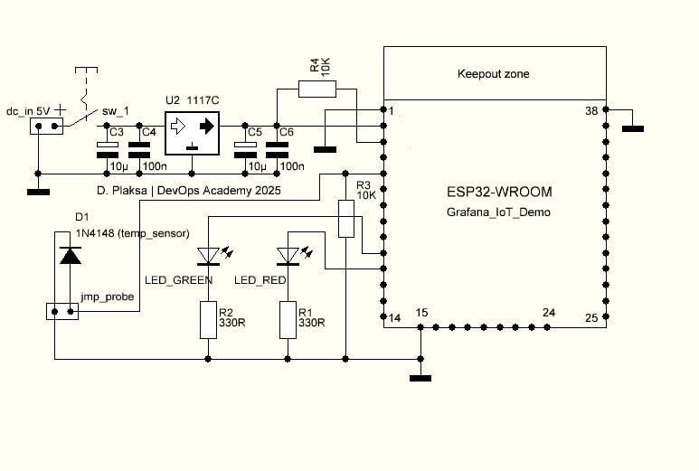
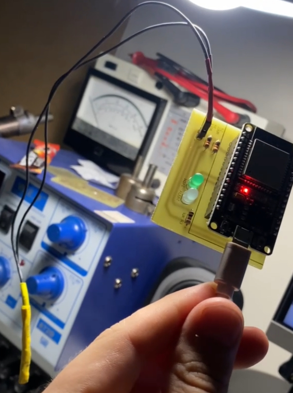
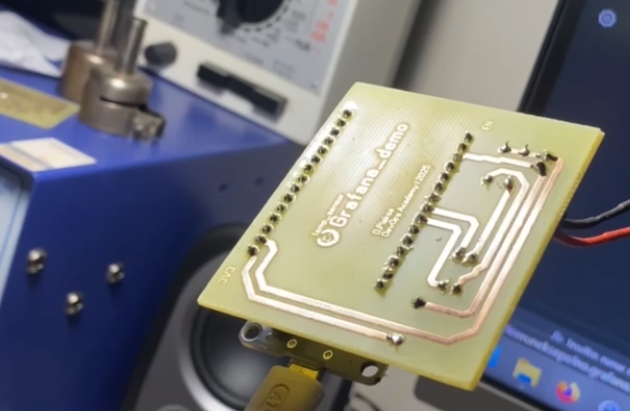
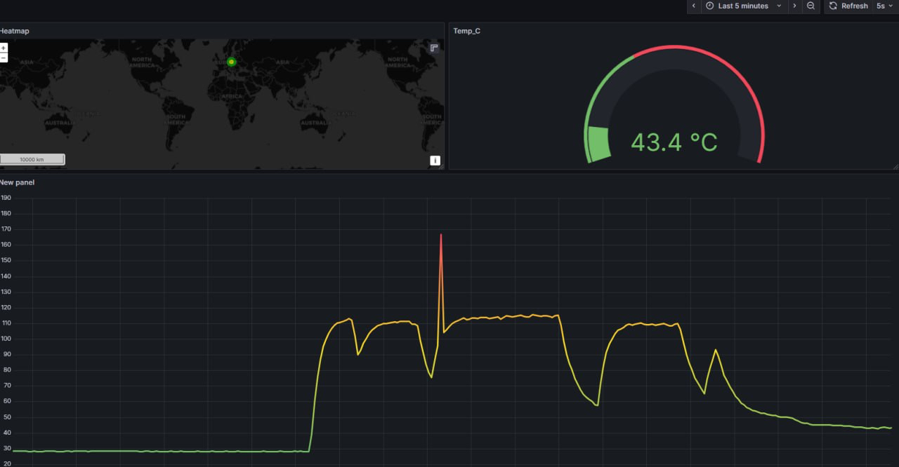

# ESP32 Temperature Monitor with Grafana Dashboard

[](https://github.com/your-repo)
[](https://github.com/your-repo)
[](https://www.python.org/)
[](https://grafana.com/)
[](https://www.silabs.com/developers/usb-to-uart-bridge-vcp-drivers)


A IoT solution that reads temperature from an **ESP32** using 1N4148 as sensor and pushes data to a **Grafana dashboard** for real-time monitoring. Built with **C++** on the hardware side and a **Python** with `.env` configuration support.






**Indication:**
- **Green LED blinking** – Wi-Fi connected successfully  
- **Red LED blinking** – Sensor threshold reached (hardcoded in C++)

---

## Features

- Real-time temperature monitoring via ESP32-WROOM
- WIFI
- Environment-based configuration using `python-dotenv`
- Grafana dashboard for data visualization




---

### Software Requirements


- [Platform IO](https://platformio.org/) - needed for flashing the ESP32 and auto-installing required C++ libraries(list of libs described in platformio.ini file)

- [Python 3.7+] 
+ Install dependencies:
```bash
pip install -r requirements.txt
```

- [CP210x driver](https://www.silabs.com/developer-tools/usb-to-uart-bridge-vcp-drivers) for USB communication with ESP32

- [Grafana](https://grafana.com) check related repo folder: "import_to_your grafana"
- [Influx DB](https://www.influxdata.com/) - provide your fluxDB pool creditionals in grafana datasources, your pool name must be "esp" or just replace "esp" with yours in all dashboard queries and in fluxDB datasource in Grafana. You can check queries and FluxDB connection setting in containerized example:

## Example of Grafana Configuration

### Docker Image

**Image:**  
[dplaksa/grafana_custom](https://hub.docker.com/r/dplaksa/grafana_custom)

### Run Command

```bash
docker run -d -p 8080:3000 dplaksa/grafana_custom:latest

```

### Environment variables:
```bash
Before flashing your ESP32, create a .env file in the repo root folder, add your secrets using the following format:

WIFI_SSID=YOUR_WIFI_SSID (Isolate spaces and special symbols with / or "" )
WIFI_PASSWORD=YOUR_PASS(Isolate spaces and special symbols with / or "" )
INFLUXDB_TOKEN="YOUR TOKEN"
INFLUXDB_URL="YOUR_URL"
INFLUXDB_ORG="YOUR_ORG"
INFLUXDB_BUCKET="YOUR_BUCKET"